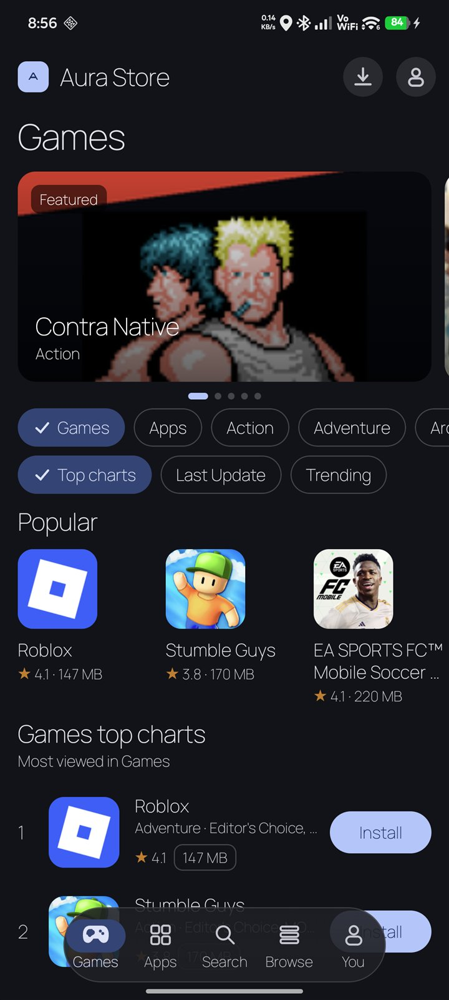
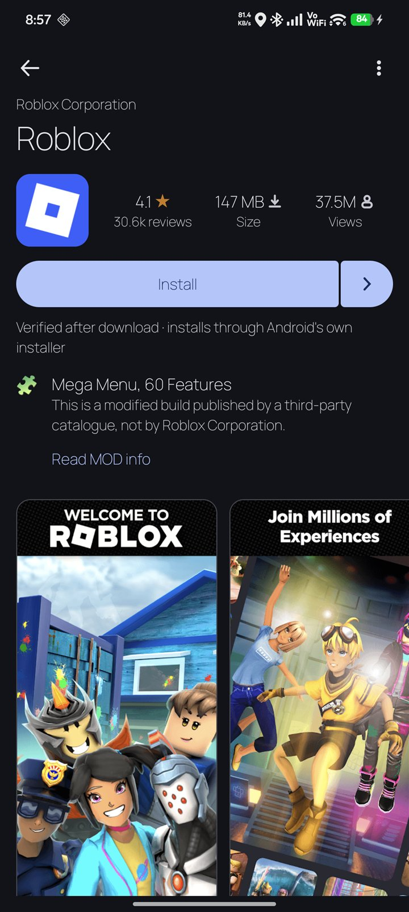
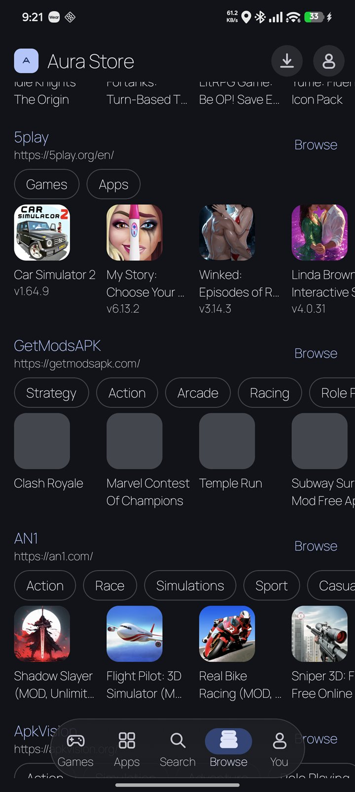
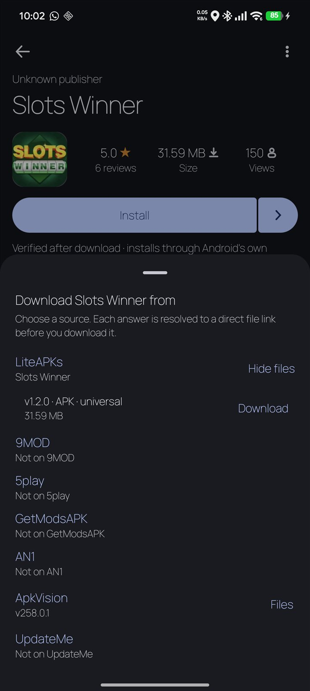

<div align="center">
  

  # Aura Store

  **A phone shop for Android. It shows you what it checked before it hands you an app.**

  <p>
    <a href="#get-the-app"></a>
    
    
    
  </p>
</div>

---

## What this is

Aura Store is an Android app that looks like the Play Store. It has shelves of apps, it opens an app
page, and the big button on it says Install.

Here is what happens when you press it.

1. The file comes down from a site the app names.
2. The phone hashes the file while it arrives, so the file is read once.
3. Android's own parser reads the file and tells the app its name, its version, and the key that
   signed it.
4. Android's own installer asks you to confirm, the same way it does for every app.

Aura Store hosts none of it. It reads other people's catalogues and shows you what they say.

Two things it does that a reader should know about. It asks for no account and sends nothing about
you anywhere: no sign-in, no analytics, no crash reports. And on a phone that grants it root, it
uses that root for one thing only: putting an app's data folder (`Android/obb`) where the system
expects it, which the system otherwise refuses to do for anyone. Say no at the prompt and the app
keeps working. It just cannot place that folder for you.

## What it looks like

| The shelves | An app page |
|---|---|
|  |  |

| The other catalogues, in Browse | Where the download comes from |
|---|---|
|  |  |

## What you can do

- **Browse.** Five shelves along the bottom. The site's own layout decides what is on them, so the
  rails, the chip labels and the orderings are the site's rather than hard coded here.
- **Search everywhere.** One search asks the catalogue and every other site at once. Each site that
  answers becomes a tab with its match count, and one tab is on screen at a time. A row from another
  site downloads from that site, without asking again.
- **Choose where a file comes from.** A download asks first. It says which sites have the app and
  which do not, and it downloads from the one you pick. Settings has a default source, and the sheet
  opens there.
- **Keep up with updates.** The You tab lists what you have installed and what is newer. Apps this
  store installed can update themselves. Apps from elsewhere are matched back by their package name
  and wait for your tap.
- **See what was checked.** Every download shows its host, its hash, its package name, its version
  and the key that signed it, before and after the install.
- **Pause and resume.** A paused download keeps its bytes. Resuming asks the server for the rest and
  hashes the part already on disk, so the final hash still covers the whole file.

## The servers the apps come from

Aura Store hosts nothing. It does not mirror or upload a single file. It reads the servers below and
shows you what they return, and each of them keeps the ownership of its content and its trademarks.

| Catalogue | What it is | The server | Where the files live |
|---|---|---|---|
| LiteAPKs | The catalogue this app is built around | liteapks.com | download.liteapks.dev, gp4.liteapks.com |
| 9MOD | WordPress catalogue with nonce-minted links | 9mod.com | gp4.9mod.com |
| 5play | DLE catalogue with signed files | 5play.org | a Cloudflare R2 bucket |
| GetModsAPK | Laravel catalogue with mirror pages | getmodsapk.com | files.5modapk.com |
| AN1 | Modded games with direct file links | an1.com | files.an1.co |
| ApkVision | WordPress with its own AJAX search | apkvision.org | dl.apkvision.org |

Each one is read in its own way: LiteAPKs through its JSON API, 9MOD and ApkVision through
WordPress, 5play and AN1 through DLE, and GetModsAPK through Laravel.

## What "verified" means here

1. SHA-256 is computed while the bytes stream, so there is no second pass over a finished file.
2. Android's package parser reads the file before it is installed: package name, version code and
   signing certificate digest.
3. Where a source publishes a digest, the result is compared. A mismatch deletes the file and fails
   the row. A malformed digest is treated as no promise, so it cannot fail a healthy download.
4. All of it is on screen before the install button matters.

That chain proves the file arrived intact, is a valid package, and carries the same signing key as
the copy you installed last time.

It does not prove the app is safe, and it does not prove it came from the original developer. A
signature says who signed the file. Nothing more.

Transport is TLS only. The manifest forbids cleartext traffic, and every HTTP client in the app also
refuses any request whose address is not `https`, which covers a redirect trying to downgrade in the
middle of a download. Backup is switched off, so the queue and the signed links it holds stay on the
phone.

None of this makes a downloaded APK safe to run.

## Get the app

Releases are on this page, under **Releases**. Download `Aura-Store-v1.1.0.apk`, open it, and let
Android install it.

1. Open the downloaded file. Android asks whether your browser or file manager may install unknown
   apps. Allow it for that app, then tap Install.
2. Open Aura Store. The Games tab loads the catalogue.
3. Aura Store needs one switch of its own before it can hand a download to the installer. Open the
   avatar in the top bar, then Settings, then Security, then *Install unknown apps*. The row says
   whether it is allowed, and the switch opens Android's own screen.
4. If a download finishes and nothing opens, the switch above is the first thing to check. The queue
   holds the file, and the install continues once the switch is on.

Android will ask you to allow installs from this app. That prompt is Android's own, and it is the
same one every sideloaded app shows.

- `minSdk` 27, so Android 8.1 and later.
- No account, no sign-in, no telemetry.
- Nothing is uploaded. Every request is a request to read a site.

The [user guide](docs/USER_GUIDE.md) covers the tabs, the source sheet, updates, games with OBB
data, storage, and what to do when a download will not start.

## Build it

You need JDK 17 and an Android SDK with API 37 installed.

```bash
./gradlew :app:assembleDebug          # debug APK
./gradlew :app:testDebugUnitTest      # JVM tests
./gradlew :app:assembleRelease        # signed release, if a keystore is configured
./gradlew :app:lintDebug              # lint
```

The release build reads its key from `local.properties`, which stays out of the repository:

```properties
AuraStoreFile=/absolute/path/to/aurastore.jks
AuraStorePassword=...
AuraStoreKeyAlias=aurastore
AuraStoreKeyPassword=...
```

Without those four values the build still succeeds and writes `app-release-unsigned.apk`, because the
file name is the clearest warning available.

R8 and resource shrinking are on, which takes the release APK to roughly 2.4 MB from the debug
build's 15 MB.

One more gate stands between the tree and the repository:

```bash
python tools/sweep_secrets.py    # no credential in the tree the repository publishes
```

It reads every tracked file and looks for the shapes a credential takes: a cloud key, a token, a
private key, a password written into a file. It fails the build when it finds one, and CI runs it
before anything is built.

## Tests

338 JVM tests across 44 classes cover the parsers, both pagers, queue persistence, the transfer core,
failure mapping, package identity, archive extraction, the shelf parsers of every source, the update
rules and the glass presets.

18 instrumented tests cover the navigation bar, saved state, row rendering and OBB placement. Run
them with a device attached:

```bash
./gradlew :app:connectedDebugAndroidTest
```

## Documentation

- [docs/USER_GUIDE.md](docs/USER_GUIDE.md) is the guide for someone using the app: install, tabs,
  downloads, updates, storage and fixes for the common failures.
- [CONTRIBUTING.md](CONTRIBUTING.md) says how a change is built, checked and sent, and what the two
  unusual gates in this repository are for.
- [docs/PROJECT_GUIDE.md](docs/PROJECT_GUIDE.md) is the orientation document: the stack, the
  source map, the data layer, the download engine, the shell, the screens and the theme.
- [docs/ARCHITECTURE.md](docs/ARCHITECTURE.md) is the technical reference: what runs where, and
  which invariants the code is not allowed to break.
- [docs/RELEASING.md](docs/RELEASING.md) says how a release is built and published.
- [SECURITY.md](SECURITY.md) says how to report something that should not be public, and
  [CODE_OF_CONDUCT.md](CODE_OF_CONDUCT.md) says how the project expects people to talk to each
  other.

## Licence

MIT. The full text is in [`LICENSE`](LICENSE). Take the code, change it, ship it.

The typeface is [Manrope](https://github.com/sharanda/manrope) by Mikhail Sharanda, SIL Open Font
License 1.1, full text in [`licenses/Manrope-OFL.txt`](licenses/Manrope-OFL.txt). A font under the
SIL Open Font License can sit inside an MIT project, and this one does.

Not affiliated with Google Play or with the apps it lists. "Play Store" belongs to Google, and the
names in the table above belong to the people who run those catalogues. This project is a client
for them, and it takes nothing of theirs but what they already serve.

## Credits

- The people who run the servers in the table above. The app would have nothing to show without
  them.
- The interface follows Google's Material 3 guidance and the Play Store's published motion tokens.
- Kotlin, Jetpack Compose, OkHttp, Coil and WorkManager, all Apache 2.0.
- The typeface is [Manrope](https://github.com/sharanda/manrope) by Mikhail Sharanda, SIL Open Font
  License 1.1, full text in [`licenses/Manrope-OFL.txt`](licenses/Manrope-OFL.txt).
- The prose in this repository is checked with [anti-ai-slop](https://github.com/misbahsy/anti-ai-slop).
